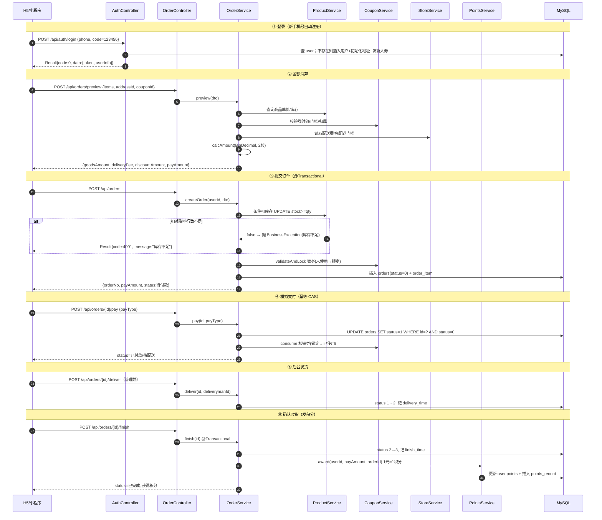
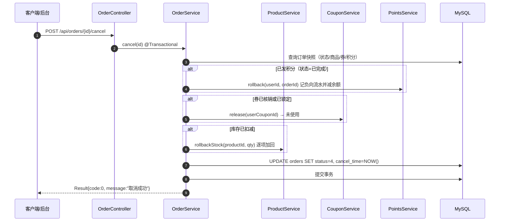
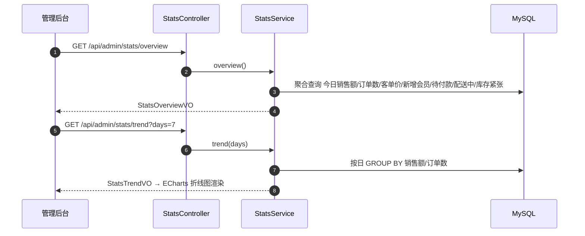
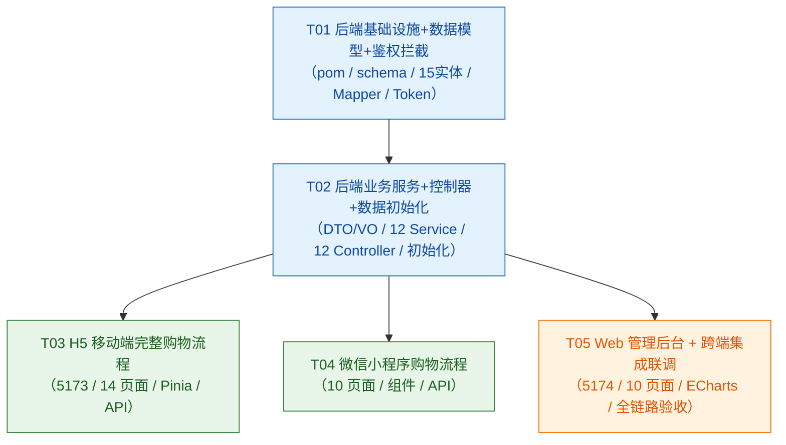

# ARCH｜邻里小超社区电商系统 — 系统架构设计与任务分解

| 项 | 内容 |
|---|---|
| Language | 简体中文 |
| Project Name | `linli_supermarket_community_ecommerce` |
| 文档版本 | v1.0 |
| 作者 | 高见远（Gao）· Architect |
| 上游输入 | `docs/PRD-邻里小超社区电商系统.md`（许清楚 v1.0） |
| 交付范围 | 完整四端（Spring Boot 后端 + H5 + 微信小程序 + Web 管理后台） |
| 工程根目录 | `D:/wordbuudy/2026-11-20-08-52-55/` |

---

# Part A · 系统设计

## 1. 实现方案与框架选型

### 1.1 核心技术难点与对策

| # | 难点 | 对策 |
|---|---|---|
| D1 | **交易一致性**：库存、优惠券、积分在订单状态流转中需正确扣减/回滚，且防超卖 | 全部写操作收敛到 `OrderService`，用 `@Transactional` 包裹；库存采用**条件更新** `UPDATE product SET stock=stock-#{n} WHERE id=#{id} AND stock>=#{n}`，按影响行数判定成功；优惠券/积分用状态 CAS 更新；演示环境单机事务即可，接口设计预留幂等键 |
| D2 | **金额准确性**：试算与提交口径必须一致，且不能信任前端 | 统一用 `BigDecimal` + `setScale(2, RoundingMode.HALF_UP)`；`preview` 与 `createOrder` 复用同一 `calcAmount()` 私有方法；下单时**后端重新读取商品单价与门店配送费**，忽略前端传入价格 |
| D3 | **多端一致性**：H5 / 小程序 / 后台字段口径统一 | 单一后端 API + 统一 `Result{code,data,message}` 包装；共享 DTO/VO 定义；三端 TypeScript 类型镜像后端 VO 字段命名（camelCase） |
| D4 | **鉴权统一**：三端 Token 签发与校验 | 自定义无状态 HMAC-SHA256 Token（userId + role + exp），`TokenInterceptor` 统一拦截；H5 存 `localStorage`，小程序存 `wx.setStorageSync`，后台存 `localStorage`；密码用 BCrypt |
| D5 | **启动自动建表 + 空库填充** | `schema.sql` 中使用 `CREATE TABLE IF NOT EXISTS`，配合 `spring.sql.init.mode=always` 自动建表；`DataInitService implements CommandLineRunner` 检测各表为空时写入演示商品/分类/配送区域/门店设置/默认管理员/演示会员 |
| D6 | **支付幂等（预留）** | `pay()` 使用 `UPDATE orders SET status=1 WHERE id=? AND status=0`，影响行数 0 直接返回当前状态，不重复核销券/发积分 |
| D7 | **配送区域可配送性** | 区县为最小单元，`delivery_area.parent_id` 自关联；下单按地址 `district` 查启用区县，停用/不存在则拒绝下单；H5 树接口过滤停用节点 |

### 1.2 框架与库选型

| 层 | 选型 | 理由 |
|---|---|---|
| 后端基座 | Java 17 + Spring Boot 3.4 | 用户指定；生态成熟、启动快、Validation/JDBC 开箱即用 |
| Web | Spring MVC + Spring Validation | 注解式参数校验（`@Valid` / `@NotNull`），减少样板代码 |
| 持久层 | MyBatis-Plus 3.5 + MySQL 8 | 单表 CRUD 零 SQL、内置分页插件、条件构造器；InnoDB 支持事务与行锁 |
| 鉴权 | 自定义 Token 拦截器 + BCrypt（`spring-security-crypto`） | 轻量、无 Session、便于三端复用；避免引入完整 Spring Security 复杂度 |
| 构建 | Maven（pom.xml） | 与 Spring Boot 官方脚手架一致 |
| H5 / 后台 | Vue 3 + TypeScript + Vite 7 + Pinia + Vue Router 4 | 用户指定；组合式 API + 类型安全；后台叠加 Element Plus + ECharts |
| 小程序 | 微信原生 + TypeScript + `miniprogram-api-typings` | 用户指定；无跨端框架开销，直接用官方 API |

### 1.3 架构模式

- **后端**：经典分层架构 `Controller → Service → Mapper → DB`，跨切面（鉴权/异常/日志）由拦截器与全局异常处理器承载；领域写操作集中在 `OrderService` 事务边界内。
- **前端**：组件化 + 状态集中管理（Pinia）；`api/` 层统一封装请求，`views/` 为页面，`components/` 为可复用组件；H5 与小程序保持相同的信息架构与字段语义。
- **数据流**：三端 → HTTPS/HTTP REST → 统一后端 → MySQL；所有展示数据以后端为唯一真相源。

---

## 2. 文件列表（相对 `D:/wordbuudy/2026-11-20-08-52-55/`）

### 2.1 后端 `springboot-supermarket/`

```
springboot-supermarket/
├── pom.xml
├── src/main/resources/
│   ├── application.yml
│   └── schema.sql
└── src/main/java/com/linli/supermarket/
    ├── SupermarketApplication.java
    ├── common/
    │   ├── Result.java
    │   ├── ResultCode.java
    │   ├── PageResult.java
    │   ├── BusinessException.java
    │   └── GlobalExceptionHandler.java
    ├── config/
    │   ├── MybatisPlusConfig.java
    │   ├── WebConfig.java
    │   └── TokenInterceptor.java
    ├── util/
    │   ├── TokenUtil.java
    │   ├── PasswordUtil.java
    │   └── UserContext.java
    ├── entity/
    │   ├── User.java               Admin.java           Category.java
    │   ├── Product.java            Cart.java            Address.java
    │   ├── Coupon.java             UserCoupon.java      PointsRecord.java
    │   ├── Orders.java             OrderItem.java       Review.java
    │   ├── DeliveryArea.java       Deliveryman.java     StoreSetting.java
    ├── mapper/
    │   ├── UserMapper.java         AdminMapper.java     CategoryMapper.java
    │   ├── ProductMapper.java      CartMapper.java      AddressMapper.java
    │   ├── CouponMapper.java       UserCouponMapper.java PointsRecordMapper.java
    │   ├── OrdersMapper.java       OrderItemMapper.java ReviewMapper.java
    │   ├── DeliveryAreaMapper.java DeliverymanMapper.java StoreSettingMapper.java
    ├── dto/
    │   ├── LoginDTO.java           AdminLoginDTO.java   CartDTO.java
    │   ├── CheckoutDTO.java        OrderQueryDTO.java   ProductQueryDTO.java
    │   ├── CouponDTO.java          AddressDTO.java      ReviewDTO.java
    │   └── CategoryDTO.java        ProductDTO.java      DeliveryAreaDTO.java
    ├── vo/
    │   ├── UserVO.java             ProductVO.java       CartVO.java
    │   ├── CheckoutPreviewVO.java  OrderVO.java         OrderItemVO.java
    │   ├── CouponVO.java           StatsOverviewVO.java StatsTrendVO.java
    │   └── DeliveryAreaVO.java
    ├── service/
    │   ├── AuthService.java        ProductService.java  CategoryService.java
    │   ├── CartService.java        AddressService.java  CouponService.java
    │   ├── PointsService.java      OrderService.java    ReviewService.java
    │   ├── DeliveryService.java    StoreService.java    StatsService.java
    │   └── DataInitService.java
    ├── service/impl/
    │   ├── AuthServiceImpl.java    ProductServiceImpl.java  CategoryServiceImpl.java
    │   ├── CartServiceImpl.java    AddressServiceImpl.java  CouponServiceImpl.java
    │   ├── PointsServiceImpl.java  OrderServiceImpl.java    ReviewServiceImpl.java
    │   ├── DeliveryServiceImpl.java StoreServiceImpl.java   StatsServiceImpl.java
    ├── controller/
    │   ├── AuthController.java     ProductController.java   CategoryController.java
    │   ├── CartController.java     AddressController.java   CouponController.java
    │   ├── OrderController.java    PointsController.java    ReviewController.java
    │   ├── DeliveryController.java StoreController.java     StatsController.java
```

### 2.2 H5 `supermarket-h5/`

```
supermarket-h5/
├── package.json
├── vite.config.ts
├── tsconfig.json
├── tsconfig.node.json
├── index.html
└── src/
    ├── main.ts
    ├── App.vue
    ├── env.d.ts
    ├── api/{request,auth,product,cart,order,coupon,address,member,store,review}.ts
    ├── router/index.ts
    ├── store/{user,cart,app}.ts
    ├── types/index.ts
    ├── utils/{auth,format}.ts
    ├── components/{TabBar,ProductCard,SkuBar,AmountPanel,AddressCard,CouponPicker,EmptyState}.vue
    ├── views/{Home,Category,ProductList,ProductDetail,Cart,Checkout,OrderList,OrderDetail,
    │          Member,Points,Coupons,Address,Service,Login}.vue
    └── styles/{global.css,variables.css}
```

### 2.3 微信小程序 `supermarket-wechat/`

```
supermarket-wechat/
├── project.config.json
├── tsconfig.json
├── package.json
├── app.ts
├── app.json
├── app.wxss
├── typings/index.d.ts
├── api/{request,product,cart,order,user,store}.ts
├── utils/{auth,util}.ts
├── components/{product-card,tab-bar}/
│   └── (每个组件含 .ts / .json / .wxml / .wxss)
├── pages/
│   ├── index/        首页
│   ├── category/     分类
│   ├── list/         商品列表
│   ├── detail/       商品详情
│   ├── cart/         购物车
│   ├── checkout/     结算
│   ├── orders/       订单列表
│   ├── order-detail/ 订单详情
│   ├── mine/         会员中心
│   └── login/        登录
│   └── (每页含 .ts / .json / .wxml / .wxss)
└── styles/common.wxss
```

### 2.4 管理后台 `supermarket-web-manager/`

```
supermarket-web-manager/
├── package.json
├── vite.config.ts
├── tsconfig.json
├── tsconfig.node.json
├── index.html
└── src/
    ├── main.ts
    ├── App.vue
    ├── api/{request,auth,product,category,order,coupon,member,review,delivery,store,stats}.ts
    ├── router/index.ts
    ├── store/{user,app}.ts
    ├── layout/Layout.vue
    ├── components/{StatCard,SalesTrendChart,PageHeader}.vue
    ├── types/index.ts
    ├── utils/auth.ts
    ├── views/{Login,Dashboard,OrderManage,ProductManage,CategoryManage,ReviewManage,
    │          MemberManage,CouponManage,DeliveryManage,StoreSetting}.vue
    └── styles/index.scss
```

---

## 3. 数据结构与接口

### 3.1 数据库表结构（15 张表）

> 统一约定：主键 `id BIGINT AUTO_INCREMENT`；`created_at` / `updated_at DATETIME DEFAULT CURRENT_TIMESTAMP`；金额 `DECIMAL(10,2)`；布尔状态 `TINYINT`（0/1）；Java 侧驼峰，DB 侧下划线（MyBatis-Plus `map-underscore-to-camel-case=true`）。

**① `user` 会员表**

| 字段 | 类型 | 说明 |
|---|---|---|
| id | BIGINT PK | 会员 ID |
| phone | VARCHAR(20) UNIQUE | 手机号（登录账号） |
| password | VARCHAR(100) | BCrypt，可空（验证码登录） |
| nickname | VARCHAR(50) | 昵称 |
| avatar | VARCHAR(255) | 头像 |
| gender | TINYINT | 0未知 1男 2女 |
| points | INT DEFAULT 0 | 当前积分 |
| status | TINYINT DEFAULT 1 | 1正常 0禁用 |

**② `admin` 管理员表**

| 字段 | 类型 | 说明 |
|---|---|---|
| id | BIGINT PK | 管理员 ID |
| username | VARCHAR(50) UNIQUE | 账号（默认 admin） |
| password | VARCHAR(100) | BCrypt（admin123） |
| real_name | VARCHAR(50) | 姓名 |
| role | VARCHAR(20) | ADMIN / STAFF |
| status | TINYINT DEFAULT 1 | 1启用 |

**③ `category` 分类表**

| 字段 | 类型 | 说明 |
|---|---|---|
| id | BIGINT PK | 分类 ID |
| name | VARCHAR(50) | 分类名（4 个一级分类） |
| icon | VARCHAR(255) | 图标 URL |
| sort | INT DEFAULT 0 | 排序（小的在前） |
| status | TINYINT DEFAULT 1 | 1启用 0停用 |

**④ `product` 商品表**

| 字段 | 类型 | 说明 |
|---|---|---|
| id | BIGINT PK | 商品 ID |
| category_id | BIGINT | 所属分类 |
| name | VARCHAR(100) | 商品名 |
| subtitle | VARCHAR(200) | 副标题 |
| code | VARCHAR(50) | 商品编码 |
| price | DECIMAL(10,2) | 售价 |
| original_price | DECIMAL(10,2) | 划线价 |
| stock | INT | 库存 |
| stock_alert | INT DEFAULT 10 | 库存紧张阈值 |
| sales | INT DEFAULT 0 | 销量 |
| unit | VARCHAR(20) | 单位（斤/个/瓶） |
| spec | VARCHAR(100) | 规格 |
| image | VARCHAR(255) | 主图 |
| images | TEXT | 轮播图 JSON 数组 |
| description | TEXT | 商品详情 |
| nutrition | TEXT | 营养信息 |
| sort | INT DEFAULT 0 | 排序 |
| is_hot | TINYINT DEFAULT 0 | 热门标记 |
| status | TINYINT DEFAULT 1 | 1上架 0下架 |

**⑤ `cart` 购物车表**

| 字段 | 类型 | 说明 |
|---|---|---|
| id | BIGINT PK | 购物车项 ID |
| user_id | BIGINT | 会员 ID |
| product_id | BIGINT | 商品 ID |
| quantity | INT | 数量 |
| selected | TINYINT DEFAULT 1 | 是否勾选 |
| — | UNIQUE(user_id,product_id) | 防重复 |

**⑥ `address` 收货地址表**

| 字段 | 类型 | 说明 |
|---|---|---|
| id | BIGINT PK | 地址 ID |
| user_id | BIGINT | 会员 ID |
| receiver | VARCHAR(50) | 收货人 |
| phone | VARCHAR(20) | 联系电话 |
| province / city / district | VARCHAR(50) | 省 / 市 / 区县（district 用于配送校验） |
| detail | VARCHAR(200) | 详细地址 |
| is_default | TINYINT DEFAULT 0 | 默认地址 |

**⑦ `coupon` 优惠券表**

| 字段 | 类型 | 说明 |
|---|---|---|
| id | BIGINT PK | 券 ID |
| name | VARCHAR(100) | 券名 |
| type | TINYINT | 1满减 2折扣 3无门槛 |
| discount | DECIMAL(10,2) | 抵扣额 / 折扣值 |
| threshold | DECIMAL(10,2) | 使用门槛（0=无门槛） |
| valid_type | TINYINT | 1固定日期 2领取后 N 天 |
| start_time / end_time | DATETIME | 固定有效期 |
| valid_days | INT | 领取后有效天数 |
| scope | TINYINT | 1全部 2新人专享 |
| total / issued | INT | 发放总量 / 已发放 |
| new_user_auto | TINYINT DEFAULT 0 | 新人自动发放开关 |
| status | TINYINT DEFAULT 1 | 1启用 0停用 |

**⑧ `user_coupon` 用户优惠券表**

| 字段 | 类型 | 说明 |
|---|---|---|
| id | BIGINT PK | 记录 ID |
| user_id / coupon_id | BIGINT | 会员 / 券 |
| status | TINYINT | 0未使用 1已使用 2已过期 |
| get_time / use_time | DATETIME | 领取 / 使用时间 |
| order_id | BIGINT | 关联订单（核销时写入） |

**⑨ `points_record` 积分明细表**

| 字段 | 类型 | 说明 |
|---|---|---|
| id | BIGINT PK | 明细 ID |
| user_id | BIGINT | 会员 ID |
| type | TINYINT | 1获取 2使用 3回滚 |
| points | INT | 变动值（可负） |
| balance | INT | 变动后余额 |
| source | VARCHAR(100) | 来源描述 |
| order_id | BIGINT | 关联订单 |

**⑩ `orders` 订单表**

| 字段 | 类型 | 说明 |
|---|---|---|
| id | BIGINT PK | 订单 ID |
| order_no | VARCHAR(64) UNIQUE | 订单号 |
| user_id / address_id | BIGINT | 会员 / 地址 |
| receiver / phone / address_detail | VARCHAR | 地址快照 |
| goods_amount | DECIMAL(10,2) | 商品金额 |
| delivery_fee | DECIMAL(10,2) | 配送费 |
| discount_amount | DECIMAL(10,2) | 优惠金额 |
| pay_amount | DECIMAL(10,2) | 应付金额 |
| coupon_id / user_coupon_id | BIGINT | 使用券（可空） |
| pay_type | VARCHAR(20) | WECHAT / ALIPAY |
| status | TINYINT | 0待付款 1已付款/待配送 2配送中 3已完成 4已取消 |
| deliveryman_id | BIGINT | 配送员 |
| pay_time / delivery_time / finish_time / cancel_time | DATETIME | 各状态时间 |
| remark | VARCHAR(255) | 备注 |

**⑪ `order_item` 订单项表**

| 字段 | 类型 | 说明 |
|---|---|---|
| id | BIGINT PK | 明细 ID |
| order_id / product_id | BIGINT | 订单 / 商品 |
| product_name / product_image | VARCHAR | 商品快照 |
| price | DECIMAL(10,2) | 下单单价快照 |
| quantity | INT | 数量 |
| total_amount | DECIMAL(10,2) | 小计 |

**⑫ `review` 评价表**

| 字段 | 类型 | 说明 |
|---|---|---|
| id | BIGINT PK | 评价 ID |
| user_id / product_id / order_id | BIGINT | 会员 / 商品 / 订单 |
| rating | INT | 1~5 星 |
| content | TEXT | 内容 |
| images | TEXT | 图片 JSON |
| status | TINYINT | 0待审核 1通过 2拒绝 |

**⑬ `delivery_area` 配送区域表（自关联）**

| 字段 | 类型 | 说明 |
|---|---|---|
| id | BIGINT PK | 区域 ID |
| parent_id | BIGINT DEFAULT 0 | 0=城市；>0=所属城市 ID |
| name | VARCHAR(50) | 城市/区县名 |
| type | TINYINT | 1城市 2区县 |
| enabled | TINYINT DEFAULT 1 | 启用状态 |
| hot | TINYINT DEFAULT 0 | 热门城市 |
| sort | INT | 排序 |

**⑭ `deliveryman` 配送员表**

| 字段 | 类型 | 说明 |
|---|---|---|
| id | BIGINT PK | 配送员 ID |
| name / phone | VARCHAR | 姓名 / 电话 |
| status | TINYINT | 1在岗 0停用 |

**⑮ `store_setting` 门店设置表（单行 id=1）**

| 字段 | 类型 | 说明 |
|---|---|---|
| id | BIGINT PK | 固定 1 |
| store_name | VARCHAR(100) | 门店名称 |
| slogan | VARCHAR(200) | 宣传语 |
| notice | VARCHAR(500) | 公告 |
| delivery_fee | DECIMAL(10,2) | 配送费 |
| free_delivery_threshold | DECIMAL(10,2) | 免配送门槛 |
| service_phone | VARCHAR(20) | 客服电话 |
| logo | VARCHAR(255) | Logo |

### 3.2 REST 接口清单

> 公共：基础路径 `/api`；响应统一 `Result{code,data,message}`（`code=0` 成功）；分页参数 `current` / `size`；受保护接口需 `Authorization: Bearer <token>`。

**鉴权 `/api/auth`**

| 方法 | 路径 | 说明 | 鉴权 |
|---|---|---|---|
| POST | `/auth/login` | 用户手机号+验证码登录（新用户自动注册） | 否 |
| POST | `/auth/admin-login` | 管理员账密登录 | 否 |
| GET | `/auth/me` | 当前登录信息 | 是 |

**商品/分类**

| 方法 | 路径 | 说明 |
|---|---|---|
| GET | `/products` | 商品列表（categoryId/keyword/status/isHot/分页） |
| GET | `/products/{id}` | 商品详情（含评价） |
| POST | `/products` | 新增商品（管理端） |
| PUT | `/products/{id}` | 编辑商品（管理端） |
| DELETE | `/products/{id}` | 删除商品（管理端） |
| PUT | `/products/{id}/status` | 上下架（管理端） |
| GET | `/categories` | 启用分类列表（前端） |
| GET | `/categories/all` | 全部分类（管理端） |
| POST | `/categories` | 新增分类（管理端） |
| PUT | `/categories/{id}` | 编辑/排序（管理端） |
| DELETE | `/categories/{id}` | 删除分类（管理端） |

**购物车 / 地址**

| 方法 | 路径 | 说明 |
|---|---|---|
| GET | `/cart` | 我的购物车 |
| POST | `/cart` | 加购 `{productId,quantity}` |
| PUT | `/cart/{id}` | 改数量 / 勾选 |
| DELETE | `/cart/{id}` | 删除单项 |
| DELETE | `/cart` | 清空已勾选 |
| GET | `/addresses` | 我的地址 |
| POST | `/addresses` | 新增地址 |
| PUT | `/addresses/{id}` | 编辑地址 |
| DELETE | `/addresses/{id}` | 删除地址 |
| PUT | `/addresses/{id}/default` | 设为默认 |

**优惠券 / 积分**

| 方法 | 路径 | 说明 |
|---|---|---|
| GET | `/coupons/available` | 当前用户可用券（按金额过滤门槛） |
| GET | `/coupons/my` | 我的优惠券 |
| POST | `/coupons/claim/{id}` | 领取券 |
| GET | `/coupons/admin` | 券列表（管理端） |
| POST | `/coupons/admin` | 新增券（管理端） |
| PUT | `/coupons/admin/{id}` | 编辑券（管理端，含新人自动发放开关） |
| DELETE | `/coupons/admin/{id}` | 删除券（管理端） |
| GET | `/points/records` | 积分明细 |
| GET | `/member/profile` | 会员资料 |

**订单 / 履约**（核心）

| 方法 | 路径 | 说明 |
|---|---|---|
| POST | `/orders/preview` | 金额试算 `{items,addressId,couponId}` |
| POST | `/orders` | 提交订单（扣库存 / 锁券） |
| GET | `/orders` | 我的订单（status 筛选） |
| GET | `/orders/{id}` | 订单详情 |
| POST | `/orders/{id}/pay` | 模拟支付 `{payType}`（核销券，幂等） |
| POST | `/orders/{id}/deliver` | 发货/配送中（管理端） |
| POST | `/orders/{id}/finish` | 确认收货（发积分） |
| POST | `/orders/{id}/cancel` | 取消订单（回滚库存/券/积分） |
| GET | `/admin/orders` | 全量订单（管理端筛选/分页） |
| GET | `/admin/orders/{id}` | 订单详情（管理端） |

**评价 / 配送 / 门店 / 统计**

| 方法 | 路径 | 说明 |
|---|---|---|
| GET | `/reviews` | 商品评价（productId，仅通过） |
| POST | `/reviews` | 提交评价 |
| GET | `/admin/reviews` | 评价列表（管理端） |
| PUT | `/admin/reviews/{id}/audit` | 审核通过/拒绝 |
| DELETE | `/admin/reviews/{id}` | 删除评价 |
| GET | `/delivery/areas` | 启用配送区域树（前端） |
| GET | `/admin/delivery/areas` | 全部区域（管理端） |
| POST/PUT/DELETE | `/admin/delivery/areas[/{id}]` | 区域增改删 |
| GET | `/admin/deliverymen` | 配送员列表 |
| POST/PUT/DELETE | `/admin/deliverymen[/{id}]` | 配送员增改删 |
| GET | `/store` | 门店设置（前端） |
| PUT | `/store` | 更新门店设置（管理端） |
| GET | `/admin/stats/overview` | 概览指标 |
| GET | `/admin/stats/trend` | 销售趋势（近 N 日） |
| GET | `/admin/stats/latest-orders` | 最新订单 |

### 3.3 类图（模块 / 数据结构 / 关系）

```mermaid
classDiagram
    direction TB

    %% ===== 实体层 =====
    class User {
      +Long id
      +String phone
      +String password
      +String nickname
      +Integer points
      +Integer status
    }
    class Admin {
      +Long id
      +String username
      +String password
      +String role
    }
    class Category {
      +Long id
      +String name
      +Integer sort
      +Integer status
    }
    class Product {
      +Long id
      +Long categoryId
      +String name
      +BigDecimal price
      +Integer stock
      +Integer stockAlert
      +Integer status
    }
    class Cart {
      +Long id
      +Long userId
      +Long productId
      +Integer quantity
      +Integer selected
    }
    class Address {
      +Long id
      +Long userId
      +String district
      +String detail
      +Integer isDefault
    }
    class Coupon {
      +Long id
      +String name
      +Integer type
      +BigDecimal discount
      +BigDecimal threshold
      +Integer newUserAuto
    }
    class UserCoupon {
      +Long id
      +Long userId
      +Long couponId
      +Integer status
      +Long orderId
    }
    class PointsRecord {
      +Long id
      +Long userId
      +Integer type
      +Integer points
      +Integer balance
    }
    class Orders {
      +Long id
      +String orderNo
      +Long userId
      +BigDecimal goodsAmount
      +BigDecimal deliveryFee
      +BigDecimal discountAmount
      +BigDecimal payAmount
      +Integer status
    }
    class OrderItem {
      +Long id
      +Long orderId
      +Long productId
      +BigDecimal price
      +Integer quantity
    }
    class Review {
      +Long id
      +Long userId
      +Long productId
      +Integer rating
      +Integer status
    }
    class DeliveryArea {
      +Long id
      +Long parentId
      +String name
      +Integer type
      +Integer enabled
      +Integer hot
    }
    class Deliveryman {
      +Long id
      +String name
      +String phone
      +Integer status
    }
    class StoreSetting {
      +Long id
      +BigDecimal deliveryFee
      +BigDecimal freeDeliveryThreshold
      +String servicePhone
    }

    %% ===== 服务层 =====
    class AuthService {
      +login(LoginDTO) UserVO
      +adminLogin(AdminLoginDTO) String
      +autoRegister(String) User
    }
    class ProductService {
      +page(ProductQueryDTO) PageResult
      +detail(Long) ProductVO
      +deductStock(Long,Integer) boolean
      +rollbackStock(Long,Integer) void
    }
    class CouponService {
      +validateAndLock(Long userId,Long ucId,BigDecimal amount) boolean
      +consume(Long ucId,Long orderId) void
      +release(Long ucId) void
    }
    class PointsService {
      +award(Long userId,BigDecimal payAmount,Long orderId) void
      +rollback(Long userId,Long orderId) void
    }
    class OrderService {
      +preview(CheckoutDTO) CheckoutPreviewVO
      +createOrder(Long userId,CheckoutDTO) Orders
      +pay(Long orderId,String payType) void
      +deliver(Long orderId,Long deliverymanId) void
      +finish(Long orderId) void
      +cancel(Long orderId) void
      -calcAmount(List~OrderItem~,Coupon,StoreSetting) CheckoutPreviewVO
    }
    class DataInitService {
      +run(String... args) void
      +initSchema() void
      +seedDemoData() void
    }

    %% ===== 控制器层 =====
    class OrderController {
      +preview(CheckoutDTO) Result
      +create(CheckoutDTO) Result
      +pay(Long,String) Result
      +deliver(Long,Long) Result
      +finish(Long) Result
      +cancel(Long) Result
    }
    class TokenInterceptor {
      +preHandle(HttpServletRequest,HttpServletResponse,Object) boolean
    }

    %% ===== 关系 =====
    Category "1" --> "0..*" Product : 分类包含
    Product "1" --> "0..*" Cart : 加入
    Product "1" --> "0..*" OrderItem : 快照
    User "1" --> "0..*" Cart : 拥有
    User "1" --> "0..*" Address : 拥有
    User "1" --> "0..*" Orders : 下单
    Orders "1" *-- "1..*" OrderItem : 组合
    User "1" --> "0..*" UserCoupon : 持有
    Coupon "1" --> "0..*" UserCoupon : 发放
    User "1" --> "0..*" PointsRecord : 积分流水
    User "1" --> "0..*" Review : 评价
    Product "1" --> "0..*" Review : 被评价
    DeliveryArea "1" --> "0..*" DeliveryArea : 自关联 市-区
    Deliveryman "1" --> "0..*" Orders : 配送

    OrderController ..> OrderService : 调用
    OrderService ..> ProductService : 扣/回滚库存
    OrderService ..> CouponService : 锁/核销/释放
    OrderService ..> PointsService : 发/回滚积分
    TokenInterceptor ..> AuthService : 校验Token
    DataInitService ..> StoreSetting : 初始化
    DataInitService ..> Admin : 初始化
```



---

## 4. 程序调用流程（时序图）

### 4.1 主旅程：登录 → 试算 → 下单 → 支付 → 配送 → 收货发积分



### 4.2 取消订单：库存 / 优惠券 / 积分回滚



### 4.3 管理后台数据概览



---

## 5. 待明确事项与假设

| # | 事项 | 本报告采用的假设（不阻塞开发） |
|---|---|---|
| A1 | 支付链路（Q1） | 模拟支付成功即CAS推进状态；`pay()` 预留幂等处理，生产再接真实回调 |
| A2 | 库存扣减时机（Q2） | 下单即扣，取消/超时回滚；单机 `@Transactional` |
| A3 | 配送粒度与分类（Q3） | 区县为最小可配送单元；分类一级（蔬菜水果/饮料零食/粮油调味/日用百货） |
| A4 | 积分比例（Q4） | 实付 1 元 = 1 积分（向下取整），确认收货发放，取消回滚 |
| A5 | 券叠加（Q5） | 单笔限一张券；新人券不叠加 |
| A6 | 验证码校验 | 演示环境固定 `123456`，不接真实短信；注册与登录同入口 |
| A7 | Token 存储 | H5/后台 `localStorage` key=`linli_token`；小程序 `wx.setStorageSync('linli_token')` |
| A8 | 图片资源 | 使用占位图 URL / Base64，不依赖外部图床 |
| A9 | 超时未支付自动取消 | 演示环境以后台手动取消为主；预留 `OrderService.cancelTimeoutOrders()` 定时任务入口 |
| A10 | 支付超时时长 | 默认 30 分钟，作为常量预留，暂不启用自动任务 |

---

# Part B · 任务分解

## 6. 依赖包清单（Required Packages）

**后端 `pom.xml`（Java 17 / Spring Boot 3.4）**

```xml
- org.springframework.boot:spring-boot-starter-web            (Spring MVC + Tomcat)
- org.springframework.boot:spring-boot-starter-validation     (参数校验)
- org.springframework.boot:spring-boot-starter-jdbc           (JDBC / 事务)
- com.baomidou:mybatis-plus-boot-starter:3.5.7                (ORM + 分页)
- com.mysql:mysql-connector-j:8.4.0                           (MySQL 8 驱动, runtime)
- org.springframework.security:spring-security-crypto         (BCryptPasswordEncoder)
- com.baomidou:mybatis-plus-generator:3.5.7                   (可选, 代码生成, provided)
```
> HikariCP 由 `spring-boot-starter-jdbc` 传递引入；Lombok 可选（如使用 `@Data` 简化实体，需在 IDE 安装插件）。

**H5 / 管理后台 `package.json`**

```
- vue@^3.5.0
- vite@^7.0.0  +  @vitejs/plugin-vue@^5.2.0
- typescript@^5.6.0  +  vue-tsc@^2.1.0
- pinia@^2.2.0
- vue-router@^4.4.0
- axios@^1.7.0
- element-plus@^2.9.0        (仅管理后台)
- @element-plus/icons-vue@^2.3.0 (仅管理后台)
- echarts@^5.5.0             (仅管理后台)
- sass@^1.80.0               (仅管理后台 index.scss)
```

**微信小程序 `package.json`**

```
- typescript@^5.6.0
- miniprogram-api-typings@^3.12.0 (devDependency)
```

---

## 7. 任务列表（有序 / 依赖 / 文件级粒度）

> 共 **5 个任务**，按依赖顺序排列。每个任务列出要创建/修改的文件、关键类与方法、依赖任务与优先级。工程师可按任务批量落地。

### T01 — 后端工程基础设施 + 数据模型 + 鉴权拦截

| 项 | 内容 |
|---|---|
| **Task ID** | T01 |
| **优先级** | P0 |
| **依赖** | 无 |
| **交付目标** | 后端可编译启动、15 张表自动创建、统一响应/异常/Token 拦截器就绪、实体与 Mapper 齐备 |

**要创建/修改的文件**

- `springboot-supermarket/pom.xml`
- `springboot-supermarket/src/main/resources/application.yml`
- `springboot-supermarket/src/main/resources/schema.sql`
- `springboot-supermarket/src/main/java/com/linli/supermarket/SupermarketApplication.java`
- `common/`：`Result.java`、`ResultCode.java`、`PageResult.java`、`BusinessException.java`、`GlobalExceptionHandler.java`
- `config/`：`MybatisPlusConfig.java`、`WebConfig.java`、`TokenInterceptor.java`
- `util/`：`TokenUtil.java`、`PasswordUtil.java`、`UserContext.java`
- `entity/`：`User`、`Admin`、`Category`、`Product`、`Cart`、`Address`、`Coupon`、`UserCoupon`、`PointsRecord`、`Orders`、`OrderItem`、`Review`、`DeliveryArea`、`Deliveryman`、`StoreSetting`（共 15 个）
- `mapper/`：对应 15 个 Mapper 接口

**关键类 / 方法**

- `Result`：静态 `ok(data)` / `fail(code,message)`；字段 `Integer code, T data, String message`
- `ResultCode`：枚举 `SUCCESS(0)`, `PARAM_ERROR(400)`, `UNAUTHORIZED(401)`, `STOCK_NOT_ENOUGH(4001)`, `COUPON_INVALID(4002)`, `ORDER_STATUS_ERROR(4003)`
- `GlobalExceptionHandler`：`@RestControllerAdvice` 捕获 `BusinessException` / `MethodArgumentNotValidException` / `Exception`
- `TokenUtil`：`createToken(Long userId,String role)`、`parse(String token)` 返回 `TokenPayload`，HMAC-SHA256，密钥来自 `app.token.secret`，有效期 7 天
- `TokenInterceptor.preHandle()`：放行白名单 `/api/auth/**`、`GET /api/products/**`、`GET /api/categories`、`GET /api/store`、`GET /api/delivery/areas`、`GET /api/reviews`；其余校验 Bearer Token 并写入 `UserContext`
- `WebConfig`：注册 `TokenInterceptor` + CORS（允许 5173/5174/小程序来源）
- `MybatisPlusConfig`：`PaginationInnerInterceptor(DbType.MYSQL)`
- `application.yml`：`server.port=8080`；`spring.datasource`；`spring.sql.init.mode=always` + `schema-locations=classpath:schema.sql`；`mybatis-plus.configuration.map-underscore-to-camel-case=true`
- `schema.sql`：15 张表 `CREATE TABLE IF NOT EXISTS`，含索引与默认行 `INSERT IGNORE INTO store_setting(id,...) VALUES(1,...)`
- 15 个 Entity 用 `@TableName` + `@TableId(type=IdType.AUTO)`；15 个 Mapper 继承 `BaseMapper<T>`

---

### T02 — 后端业务服务 + 控制器 + 数据初始化

| 项 | 内容 |
|---|---|
| **Task ID** | T02 |
| **优先级** | P0 |
| **依赖** | T01 |
| **交付目标** | 全部 REST 接口可用；金额试算/库存/券/积分/状态流转正确；启动自动填充演示数据 |

**要创建/修改的文件**

- `dto/`：登录、管理员登录、购物车、结算 `CheckoutDTO`、订单查询、商品查询、优惠券、地址、评价、分类、商品、配送区域（共 12 个）
- `vo/`：`UserVO`、`ProductVO`、`CartVO`、`CheckoutPreviewVO`、`OrderVO`、`OrderItemVO`、`CouponVO`、`StatsOverviewVO`、`StatsTrendVO`、`DeliveryAreaVO`
- `service/` + `service/impl/`：12 个业务服务接口与实现
- `service/DataInitService.java`（`CommandLineRunner`）
- `controller/`：`AuthController`、`ProductController`、`CategoryController`、`CartController`、`AddressController`、`CouponController`、`OrderController`、`PointsController`、`ReviewController`、`DeliveryController`、`StoreController`、`StatsController`

**关键类 / 方法**

- `AuthServiceImpl.login(LoginDTO)`：验证码==`123456` 校验；新手机号 `autoRegister()` 建用户 + 默认地址 + 新人券返回 `token`；`adminLogin` 用 `BCryptPasswordEncoder.matches`
- `ProductServiceImpl`：`page()` 条件分页、`detail()` 含评价、`deductStock(id,n)` 用 `UPDATE ... WHERE stock>=n` 返回布尔、`rollbackStock()`
- `CouponServiceImpl`：`validateAndLock(userId,userCouponId,amount)` 校验有效期/归属/门槛并把 `user_coupon.status 0→3(锁定)`；`consume()` `3→1`；`release()` `→0`
- `PointsServiceImpl.award()`：`int points = payAmount.setScale(0,DOWN).intValue()`；更新 `user.points` + 插 `points_record(type=1)`；`rollback()` 记 `type=3` 负向
- **`OrderServiceImpl`（核心）**：
  - `preview(CheckoutDTO)` → `calcAmount()`：读商品单价、`StoreSetting.deliveryFee` / `freeDeliveryThreshold`、券门槛，返回明细
  - `createOrder()` `@Transactional`：二次校验价格/配送费 → 条件扣库存 → 锁券 → 校验区县可配送 → 插订单/订单项
  - `pay()` `@Transactional`：CAS `status 0→1`，核销券，重入直接返回
  - `deliver()`：`status 1→2`
  - `finish()` `@Transactional`：`status 2→3` + 发积分
  - `cancel()` `@Transactional`：按当前状态回滚积分/券/库存 → `status=4`
- `StatsServiceImpl`：`overview()` 多聚合查询、`trend(days)` 按日分组、`latestOrders(limit)`
- `DataInitService.run()`：检测空表后写入——4 个分类；≥16 个演示商品（含库存紧张样本）；城市/区县配送区域（含热门）；`store_setting`；默认管理员 `admin`/BCrypt(`admin123`)；演示会员 `13912348765`（含地址/购物车/券/历史订单）
- 每个 Controller 使用 `@Valid` + `@RequestBody`，统一返回 `Result.ok(data)`

---

### T03 — H5 移动端完整购物流程

| 项 | 内容 |
|---|---|
| **Task ID** | T03 |
| **优先级** | P0 |
| **依赖** | T01、T02（需 API 契约） |
| **交付目标** | 移动端浏览器可完成主旅程；端口 5173；底部 Tab + 全部页面 |

**要创建/修改的文件**

- 配置：`package.json`、`vite.config.ts`（proxy `/api` → `http://localhost:8080`）、`tsconfig.json`、`tsconfig.node.json`、`index.html`、`src/main.ts`、`src/App.vue`、`src/env.d.ts`
- `src/api/`：`request.ts` + auth/product/cart/order/coupon/address/member/store/review（10 个）
- `src/router/index.ts`、`src/store/{user,cart,app}.ts`、`src/types/index.ts`、`src/utils/{auth,format}.ts`
- `src/components/`：`TabBar`、`ProductCard`、`SkuBar`、`AmountPanel`、`AddressCard`、`CouponPicker`、`EmptyState`
- `src/views/`：`Home`、`Category`、`ProductList`、`ProductDetail`、`Cart`、`Checkout`、`OrderList`、`OrderDetail`、`Member`、`Points`、`Coupons`、`Address`、`Service`、`Login`
- `src/styles/{global.css,variables.css}`

**关键类 / 方法**

- `api/request.ts`：axios 实例 `baseURL='/api'`；请求拦截器注入 `Bearer ${getToken()}`；响应拦截器拆包 `Result`，`code!==0` 弹Toast，`401` 跳登录
- `store/user.ts`：`token`、`profile`、`login(phone,code)`、`logout()`、`fetchProfile()`；持久化 `linli_token`
- `store/cart.ts`：`items`、`add()`、`updateQty()`、`toggleSelect()`、`remove()`、`sync()`（与后端双向同步，勾选结算只取 selected）
- `views/Checkout.vue`：进页面 `GET /coupons/available` + 地址；勾选/改券时调 `/orders/preview` 实时刷新金额明细；提交调 `POST /orders` 后跳支付
- `views/OrderDetail.vue`：按 status 展示操作按钮（待付款→取消/支付；已付款→取消；配送中→确认收货）；支付弹窗选微信/支付宝，调 `/orders/{id}/pay`
- `router/index.ts`：需登录路由 `meta.requiresAuth`，守卫读 `store.user.token`

---

### T04 — 微信小程序购物流程

| 项 | 内容 |
|---|---|
| **Task ID** | T04 |
| **优先级** | P0 |
| **依赖** | T01、T02（需 API 契约） |
| **交付目标** | 微信开发者工具可导入编译，覆盖浏览/下单/订单/会员主流程 |

**要创建/修改的文件**

- 配置：`project.config.json`、`tsconfig.json`、`package.json`、`app.ts`、`app.json`（注册页面与 tabBar）、`app.wxss`、`typings/index.d.ts`
- `api/`：`request.ts` + product/cart/order/user/store（6 个）
- `utils/{auth,util}.ts`
- `components/product-card/`、`components/tab-bar/`（各含 `.ts/.json/.wxml/.wxss`）
- `pages/`：`index`、`category`、`list`、`detail`、`cart`、`checkout`、`orders`、`order-detail`、`mine`、`login`（各含 4 文件）
- `styles/common.wxss`

**关键类 / 方法**

- `utils/request.ts`：Promise 封装 `wx.request({url: BASE_URL+path, header:{Authorization}})`，统一拆包 `Result`，`wx.showToast` 报错
- `utils/auth.ts`：`getToken()` / `setToken()` / `ensureLogin()`（未登录跳 `/pages/login/login`）
- `app.ts`：`globalData.token`，`onLaunch` 恢复本地 token
- `pages/index`、`pages/category`、`pages/detail`：调用 `/products`、`/categories`、`/products/{id}`
- `pages/cart` + `pages/checkout`：复用 H5 交互语义，勾选改量、试算、提交；支付用 `wx.showActionSheet` 选微信/支付宝后调 `/orders/{id}/pay`
- `pages/mine`：登录、资料、积分、券、地址、客服入口

---

### T05 — Web 管理后台 + 跨端集成联调

| 项 | 内容 |
|---|---|
| **Task ID** | T05 |
| **优先级** | P0 |
| **依赖** | T01、T02（需 API 契约） |
| **交付目标** | 后台九大模块可用；完成四端联调与主旅程验收；端口 5174 |

**要创建/修改的文件**

- 配置：`package.json`、`vite.config.ts`（proxy `/api` → 8080，port 5174）、`tsconfig.json`、`tsconfig.node.json`、`index.html`、`src/main.ts`、`src/App.vue`
- `src/api/`：`request.ts` + auth/product/category/order/coupon/member/review/delivery/store/stats（11 个）
- `src/router/index.ts`、`src/store/{user,app}.ts`、`src/layout/Layout.vue`、`src/components/{StatCard,SalesTrendChart,PageHeader}.vue`、`src/types/index.ts`、`src/utils/auth.ts`、`src/styles/index.scss`
- `src/views/`：`Login`、`Dashboard`、`OrderManage`、`ProductManage`、`CategoryManage`、`ReviewManage`、`MemberManage`、`CouponManage`、`DeliveryManage`、`StoreSetting`

**关键类 / 方法**

- `api/request.ts`：axios + `ElMessage.error` 统一报错；管理员 Token 注入（与用户端同 `linli_token`，登录时覆盖）
- `layout/Layout.vue`：`el-container` 左菜单 + 顶栏 + `router-view`；菜单项对应九大模块
- `views/Dashboard.vue`：`StatCard` × 8（销售额/订单/客单价/新增会员/待付款/配送中/库存紧张/…）+ `SalesTrendChart`（ECharts 折线）+ 最新订单表格
- `views/OrderManage.vue`：筛选 + 表格 + 详情抽屉 + 状态流转按钮（付款/配送/完成/取消）
- `views/ProductManage.vue`：筛选（含库存紧张）+ 表格 + 新增/编辑弹窗（价格/库存/分类/图片/编码/排序/上下架）
- `views/CouponManage.vue`：券 CRUD 表单（类型/门槛/有效期/发放范围/新人自动发放开关/核销状态）
- `views/DeliveryManage.vue`：城市/区县树维护（启用/热门/配送员）
- `views/StoreSetting.vue`：门店名称/宣传语/配送费/免配送门槛/客服电话
- **集成联调**：启动 8080/5173/5174，验证「登录→加购→试算→支付→配送→收货发积分→后台看板更新」全链路；对齐三端字段口径；修复接口联调问题

---

## 8. 跨文件共享约定（Shared Knowledge）

工程师实现所有文件时必须遵守以下统一约定：

1. **响应包装**：所有接口返回 `{ "code": 0, "data": ..., "message": "ok" }`；`code=0` 成功，非 0 失败；前端统一在 `request` 层拆包。
2. **鉴权头**：`Authorization: Bearer <token>`；Token key 前后端统一为 `linli_token`；后端白名单见 T01。
3. **金额**：后端一律 `BigDecimal`，输出保留 2 位小数；前端展示 `¥xx.xx`；禁止用 `float/double` 计算金额。
4. **日期时间**：后端 `LocalDateTime`，JSON 序列化为 `yyyy-MM-dd HH:mm:ss`；前端原样展示。
5. **状态枚举（前后端共用同一数值）**：
   - 订单 `status`：`0待付款 1已付款/待配送 2配送中 3已完成 4已取消`
   - 用户券 `status`：`0未使用 1已使用 2已过期 3锁定`
   - 商品 `status`：`0下架 1上架`；分类/区域/管理员 `status`：`1启用 0停用`
   - 积分流水 `type`：`1获取 2使用 3回滚`；评价 `status`：`0待审核 1通过 2拒绝`
6. **分页**：请求参数 `current`（从 1 起）、`size`；响应 `{records, total, current, size}`（MyBatis-Plus `Page` 结构）。
7. **命名**：DB 下划线（如 `goods_amount`），Java/TS 驼峰（`goodsAmount`）；MyBatis-Plus 开启下划线转驼峰。
8. **路径与端口**：后端 `http://localhost:8080`，API 前缀 `/api`；H5 `5173`、后台 `5174`，Vite 均用 proxy 转发 `/api`；小程序直连 `http://localhost:8080/api`（开发者工具勾选「不校验合法域名」）。
9. **错误码**：库存不足 `4001`、券无效/门槛不足 `4002`、订单状态非法 `4003`、未登录 `401`、参数错误 `400`。
10. **演示数据口径**：用户 `13912348765`/`123456`；管理员 `admin`/`admin123`；验证码固定 `123456`；积分 1 元=1 积分；单笔限一张券。
11. **事务边界**：所有写操作（下单/支付/配送/收货/取消）的服务方法加 `@Transactional`，异常统一抛 `BusinessException` 由全局处理器回滚。

## 9. 任务依赖图



> **并行说明**：T02 完成后，T03 / T04 / T05 可并行开工（共享同一后端 API 契约）；T05 末尾负责跨端集成联调。

---

## 附：交付检查清单（供工程师/QA 对照）

- [ ] 后端 `mvn spring-boot:run` 可启动，MySQL 为空库时自动建 15 表并填充演示数据
- [ ] `admin/admin123` 登录后台；`13912348765/123456` 登录 H5 与小程序
- [ ] 金额试算 = 商品金额 + 配送费（达门槛免）− 券优惠，2 位小数，提交时后端二次校验
- [ ] 下单扣库存、库存不足禁止下单；取消/超时按状态回滚库存/券/积分
- [ ] 支付 CAS 幂等；确认收货发积分（1元=1积分）并写明细
- [ ] 配送区域按区县校验，停用区域 H5 不展示且不可下单
- [ ] 订单状态流转全通；后台九大模块 CRUD 与看板可用
- [ ] H5（5173）、后台（5174）、小程序（开发者工具）三端数据一致
